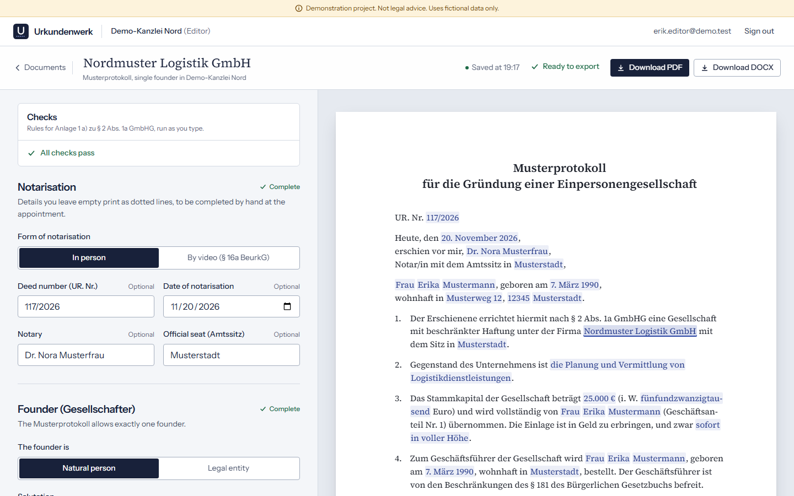
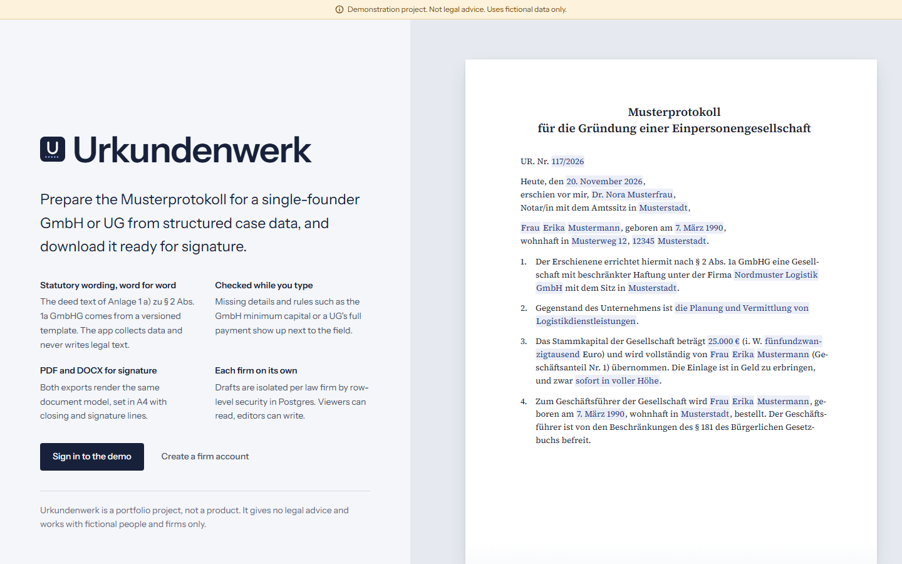

# Urkundenwerk

Urkundenwerk is an AI-assisted document builder for German law firms. Its first
planned workflow covers forming a German GmbH with the statutory
`Musterprotokoll` (Anlage 1 GmbHG) and preparing the `Handelsregisteranmeldung`.
A lawyer fills in structured data for a single-founder GmbH or UG and gets a
signature-ready Musterprotokoll (Anlage 1 a) GmbHG) as PDF or DOCX. The deed
text is assembled deterministically from a versioned template; the app only
collects data.

> **Demonstration project. Not legal advice.** Urkundenwerk uses fictional case
> data and public legal texts only.



## Features

- **Musterprotokoll builder.** A form in the order of the deed, with a live A4
  preview built in the browser from the same `DocumentModel` that the exports
  use. Missing values show as labelled dotted lines and filled values in ink.
  Choosing either in the preview focuses its field.
- **Rule checks while typing.** A deterministic rule engine in core checks
  the data against the GmbHG and the BeurkG: minimum and UG capital, the
  payment due before registration, the legal form in the Firma, who may be
  Geschäftsführer and from what age, dates of birth and notarisation, business
  purposes that are too general, and the formation cost cap. Each rule has a
  stable code, a severity, and a legal reference. Findings appear next to the
  field and in a **Checks** panel that links to the field. Errors block the
  download; warnings and notes do not.
- **AI explanations, optional.** Any finding can be explained in plain
  English by an LLM. The rules decide; the model only explains, and its
  answers are labelled as AI-generated and not legal advice. See
  [AI explanations](#ai-explanations).
- **Drafts that survive.** Changes are saved automatically after a short pause,
  with a visible and announced save status. A new document takes its Firma as
  its title.
- **PDF and DOCX exports.** A Node route handler validates the stored draft
  with the schema and the rules and returns the rendered file, or `422` with
  the paths and rule codes of the errors.
- **Firms and roles.** Each firm sees only its own documents. Editors and
  admins write. Viewers get a read-only builder and can download. Members of
  several firms switch between them.

The design direction is recorded in [`docs/design.md`](docs/design.md).

| Landing page                                  | Documents of a firm                              |
| --------------------------------------------- | ------------------------------------------------ |
|  |  |

## Roadmap

| Milestone                                                                      | Scope                                                                  | Status  |
| ------------------------------------------------------------------------------ | ---------------------------------------------------------------------- | ------- |
| [M1 · Foundation](https://github.com/Timerk/urkundenwerk/issues/1)             | Monorepo, CI, Supabase Auth, and row-level security (RLS)              | Done    |
| [M2 · Template engine](https://github.com/Timerk/urkundenwerk/issues/2)        | Deterministic DOCX and PDF rendering                                   | Done    |
| [M3 · Rule checks](https://github.com/Timerk/urkundenwerk/issues/3)            | Validation of structured formation data                                | Done    |
| [M4 · AI extraction](https://github.com/Timerk/urkundenwerk/issues/4)          | Extract structured data with source citations and evaluate the results | Planned |
| [M5 · XML export](https://github.com/Timerk/urkundenwerk/issues/5)             | Export registry XML and validate it against an XSD                     | Planned |
| [M6 · MCP server](https://github.com/Timerk/urkundenwerk/issues/6)             | Expose the shared domain workflows over MCP                            | Planned |
| [M7 · Audit, roles, and GDPR](https://github.com/Timerk/urkundenwerk/issues/7) | Audit log, role-based access, and data protection workflows            | Planned |
| [M8 · Deployment](https://github.com/Timerk/urkundenwerk/issues/8)             | Deploy the portfolio demo                                              | Planned |

## Stack and layout

The project uses pnpm, Next.js App Router, React, TypeScript, Tailwind CSS, Zod,
and Supabase (Postgres, Auth, and RLS). Vitest, pgTAP, and Playwright run in
GitHub Actions, and Docker Compose runs the standalone web build locally.
Vercel is planned.

| Path                                 | Purpose                                                                     |
| ------------------------------------ | --------------------------------------------------------------------------- |
| [`apps/web`](apps/web)               | Next.js app, Playwright tests, and Dockerfile                               |
| [`packages/core`](packages/core)     | Framework-free TypeScript domain package and Zod schemas                    |
| [`packages/render`](packages/render) | Node DOCX and PDF export for the [template engine](packages/core/README.md) |
| [`packages/ai`](packages/ai)         | Server-only LLM port, Anthropic and fake adapters, and explanations         |
| [`supabase`](supabase)               | Migrations, seed data, pgTAP tests, and local config                        |
| [`docs/adr`](docs/adr)               | Architecture decisions                                                      |

The shared TypeScript config enables `strict` and `noUncheckedIndexedAccess`.
It leaves `exactOptionalPropertyTypes` off so app and schema types can use the
same optional property conventions as Next.js and Zod.

## Local development

Use Node.js 24 LTS (`.nvmrc`), pnpm 12.23.0, and a running Docker engine (for
example Docker Desktop) for the local Supabase stack.

```sh
pnpm install --frozen-lockfile
pnpm db:start   # Postgres, Auth, and the Data API; applies migrations and seed data
pnpm db:env     # writes the local URL and publishable key to apps/web/.env.local
pnpm dev
```

Open <http://localhost:3000> and sign in with one of the fictional demo users.
Their password is `demo-password-123`. It exists only in the local seed data.

| Email                     | Firm              | Role   |
| ------------------------- | ----------------- | ------ |
| `anna.admin@demo.test`    | Demo-Kanzlei Nord | admin  |
| `erik.editor@demo.test`   | Demo-Kanzlei Nord | editor |
| `victor.viewer@demo.test` | Demo-Kanzlei Nord | viewer |
| `sara.admin@demo.test`    | Demo-Kanzlei Süd  | admin  |
| `mia.multi@demo.test`     | Demo-Kanzlei Nord | editor |
| `mia.multi@demo.test`     | Demo-Kanzlei Süd  | viewer |

Each firm has one fictional draft: a complete Musterprotokoll for Nord and an
unfinished one for Süd.

Local sign-up skips email confirmation (`[auth.email]` in
[`supabase/config.toml`](supabase/config.toml)), so `/signup` signs the new
user in and creates their firm immediately. Hosted Auth settings are part of
the deployment milestone. [`.env.example`](.env.example) lists all variables.
The other keys there are reserved for later integrations.

To run the production image locally, use `docker compose up --build` and open
the same URL. The image serves the public pages; the authenticated area needs
the Supabase variables at runtime.

| Command                             | Purpose                                              |
| ----------------------------------- | ---------------------------------------------------- |
| `pnpm lint`                         | Check JavaScript and TypeScript with ESLint          |
| `pnpm format` / `pnpm format:check` | Write or check formatting with Prettier              |
| `pnpm typecheck`                    | Type-check all workspace packages                    |
| `pnpm test`                         | Run the workspace unit tests                         |
| `pnpm build`                        | Build the standalone production app                  |
| `pnpm test:e2e`                     | Run the Chromium tests against the production build  |
| `pnpm db:start` / `pnpm db:stop`    | Start or stop the local Supabase stack               |
| `pnpm db:reset`                     | Recreate the local database from migrations and seed |
| `pnpm db:test`                      | Run the pgTAP database tests                         |
| `pnpm db:lint`                      | Lint the database schema                             |
| `pnpm db:types`                     | Regenerate `packages/core/src/db/database.types.ts`  |
| `pnpm db:env`                       | Write the local Supabase variables for the web app   |

Before running the end-to-end tests locally, install Chromium with
`pnpm --filter @urkundenwerk/web exec playwright install chromium`, start the
database with `pnpm db:start`, and run `pnpm build`. To refresh the README
screenshots, run `pnpm db:reset` and then
`SCREENSHOTS=1 pnpm test:e2e e2e/screenshots.spec.ts`.

## AI explanations

The rule engine finds the issues. An LLM may then explain one in plain
English, with a suggested fix. This follows
[ADR-0002](docs/adr/0002-deterministic-legal-text.md): the model never
decides whether data is valid and never writes deed text.

- **What is sent.** Only the rule code, its legal reference, the rule's
  one-sentence summary, and the issue's params, which are numbers and
  booleans such as amounts and limits. Names, dates of birth, addresses, the
  Firma, and other text from the draft have no field to travel in. A test
  checks the request for them.
- **What comes back.** At most three sentences and a suggested fix per
  issue, checked against the asked-for codes. Anything else, and any failure,
  falls back to the rule's own summary. The panel shows the model and the
  prompt version.
- **Limits.** Only members of the document's firm can ask, ten times a
  minute. Answers are cached by code, params, model, and prompt version.
- **Design.** A provider-agnostic port with an Anthropic adapter, a scripted
  fake, timeouts, and one retry. See
  [ADR-0007](docs/adr/0007-llm-port-and-adapters.md). Extraction in M4 builds
  on the same port.

Explanations are off unless configured. To use your own key, add it to
`apps/web/.env.local`, which Git ignores:

```sh
ANTHROPIC_API_KEY=<your key>  # turns AI_PROVIDER=anthropic on
# AI_PROVIDER=fake            # scripted answers without a key or network
# AI_MODEL_EXPLAIN=claude-haiku-5-5
```

The production server reads these at request time. Tests and CI use
`AI_PROVIDER=fake` and never call a paid API.

## Security model

- **Tenants.** Each law firm is a tenant. Users get access to a tenant only
  through a row in `tenant_memberships`, so one user can belong to several
  firms.
- **Roles.** `admin` manages the firm and its members, `editor` creates and
  edits documents, and `viewer` reads them. Only admins add, change, or remove
  memberships, and every tenant keeps at least one admin.
- **Row-level security.** Postgres enforces isolation, not the app. Every
  table in `public` has RLS enabled and forced, with policies for the
  `authenticated` role only. The policies use `SECURITY DEFINER` helpers in a
  `private` schema that the Data API does not expose. Anonymous requests have
  no table privileges. See [ADR-0003](docs/adr/0003-tenancy-with-row-level-security.md).
- **Documents.** `documents` rows store structured input, never legal text.
  Members read their firm's documents, editors and admins write them, and
  column grants keep the tenant, template version, and author fixed. Server
  actions and the export route use the signed-in user's Supabase client, so
  RLS authorizes every query. See
  [ADR-0005](docs/adr/0005-document-drafts.md).
- **Authentication.** The Next.js proxy refreshes the Supabase session.
  Protected pages verify the user with the Auth server through
  `supabase.auth.getUser()` and do not trust the session cookie alone.
- **Data minimisation.** `profiles` stores a display name only. Email
  addresses stay in Supabase Auth.
- **Tests.** pgTAP tests in [`supabase/tests`](supabase/tests) check RLS on
  every table through the catalog, so new tables are covered automatically.
  They also sign in as members of two tenants and prove that reads, writes,
  role escalation, and anonymous access across tenants fail. Playwright covers
  sign-in, sign-up, the redirect for unauthenticated users, the builder for
  editors and viewers, and documents and exports across firms.

## How this project is built

An orchestrating agent plans milestones and reviews pull requests.
Implementation agents work on feature branches. Changes land through reviewed
pull requests with green CI and are squash-merged using the PR title as the
commit message. The engineering conventions are in [`AGENTS.md`](AGENTS.md).
