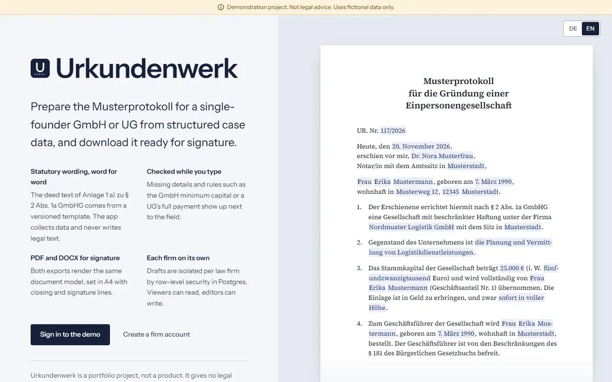
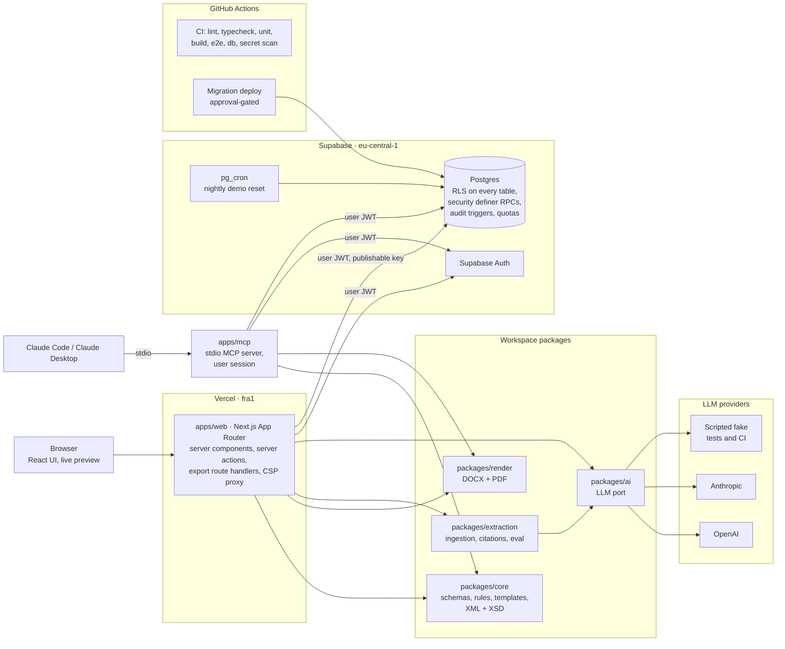
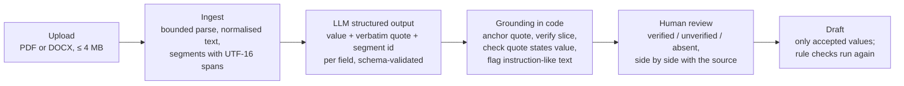
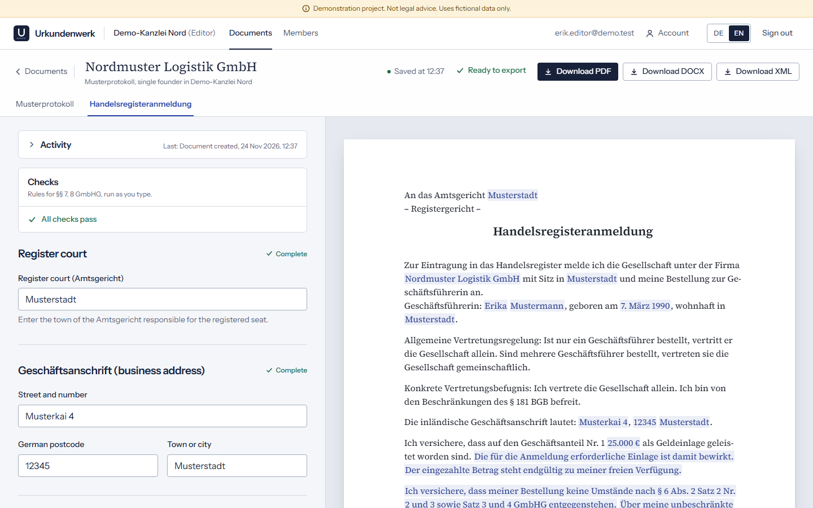
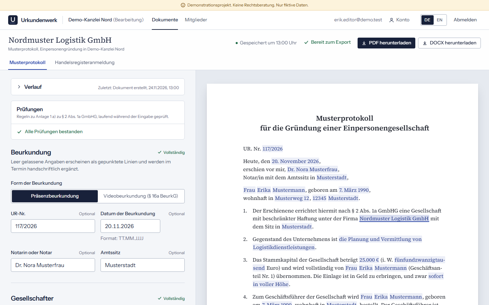
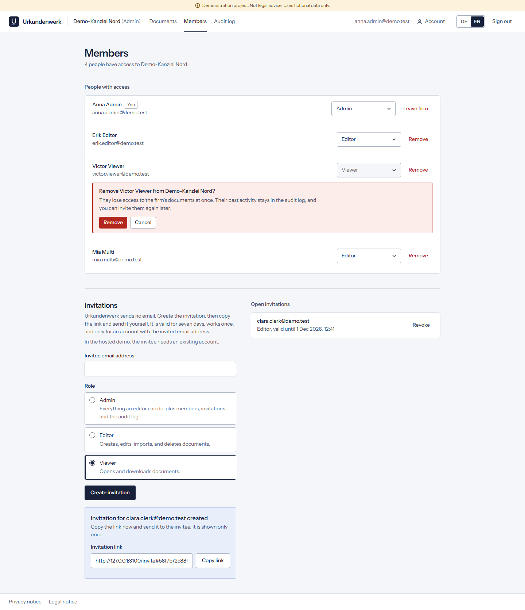
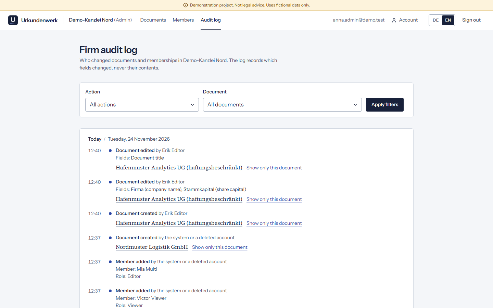

# Urkundenwerk

[](https://github.com/Timerk/urkundenwerk/actions/workflows/ci.yml)
[](LICENSE)

Urkundenwerk is an AI-assisted document builder for German law firms. It
prepares the statutory Musterprotokoll (Anlage 1 a) GmbHG) and a draft
Handelsregisteranmeldung for a single-founder GmbH or UG. Legal text is
assembled deterministically from versioned templates and validated
structured data. LLMs only extract data from uploaded contracts and explain
rule findings, and a human reviews every extracted value. Firms are isolated
by PostgreSQL row-level security, and an MCP server lets Claude Code act as
the signed-in user.

> **Demonstration project. Not legal advice.** Urkundenwerk uses fictional
> case data and public legal texts only.

**▶ Live demo: [urkundenwerk.vercel.app](https://urkundenwerk.vercel.app)**:
choose a fictional demo account (editor, viewer, a member of two firms, or
the admin of a sandbox firm) and sign in with one click. The demo firms are
reset nightly.



_A short, silent walkthrough of a fictional case in Urkundenwerk._


**Contents:** [What it does](#what-it-does) ·
[Architecture](#architecture) · [Key design decisions](#key-design-decisions) ·
[Evaluation](#evaluation) · [Security and privacy](#security-and-privacy) ·
[Skills demonstrated](#skills-demonstrated) ·
[How this was built](#how-this-was-built) ·
[Limitations](#honest-limitations) · [Local development](#local-development) ·
[Roadmap](#roadmap)

## What it does

1. **Fill in the deed.** A form in the order of the Musterprotokoll, with a
   live A4 preview built from the same document model as the PDF and DOCX
   exports. Missing values appear as labelled blanks; clicking one focuses
   its field. Drafts save automatically.
2. **Check it while typing.** A deterministic rule engine checks the data
   against the GmbHG and BeurkG: capital, UG limits, payment, who may be
   Geschäftsführer, dates, an overly general business purpose, and the cost
   cap. Each finding has a stable code, a severity, and a legal reference.
   Errors block the download. An LLM can explain any finding in plain
   language; the rules decide, the model only explains.
3. **Or import a contract.** Upload an existing deed or articles as PDF or
   DOCX. An LLM proposes values, each with a verbatim quote. Urkundenwerk's
   code checks that every quote exists in the document and states the
   value. You accept, edit, or clear each value next to the source passage
   before a draft is created.
4. **Prepare the register filing.** Add the court, business address, and
   managing director's assurances, then download the
   Handelsregisteranmeldung as PDF or DOCX and the filing data as XML,
   validated against a [versioned XSD](packages/core/schemas/registeranmeldung-v1.xsd).
5. **Work as a firm.** Admins, editors, and viewers per firm; one-use
   invitation links; a per-document **Verlauf** (history) and a firm audit
   log; account data download and erasure.
6. **In German or English.** The whole UI switches between DE and EN
   without losing typed input. Documents stay German.
7. **Let an agent do it.** A local MCP server lets Claude Code or Claude
   Desktop create, fill in, check, and export drafts with the user's own
   permissions ([`apps/mcp`](apps/mcp/README.md)).

## Architecture



Every request reaches Postgres with the signed-in user's JWT and the
publishable key, so RLS decides what any client sees: the browser, the
server actions, the export route, and the MCP server. The web app holds no
Supabase secret key. `packages/core` is framework-free and shared by the
web app and the MCP server.

### AI extraction pipeline



Nothing is stored before the user creates the draft. The uploaded file,
its text, and the raw model response are never persisted
([ADR-0008](docs/adr/0008-ingestion-citations-and-evaluation.md),
[ADR-0009](docs/adr/0009-llm-extraction-with-verified-citations.md)).

## Key design decisions

- **Deterministic legal text.** Documents are assembled from versioned
  templates and validated data, never generated by an LLM. Exports are
  byte-reproducible and tested against goldens
  ([ADR-0002](docs/adr/0002-deterministic-legal-text.md),
  [ADR-0004](docs/adr/0004-document-model-and-renderers.md)).
- **Multi-tenancy in the database.** All firms share tables; RLS policies
  call `security definer` helpers in a private schema. pgTAP fails CI for
  any table without RLS
  ([ADR-0003](docs/adr/0003-tenancy-with-row-level-security.md)).
- **No secret key in the app.** Quotas, the AI budget, invitations, and
  account erasure run as narrow RPCs under the caller's session. The MCP
  server refuses service keys
  ([ADR-0011](docs/adr/0011-mcp-server-with-user-session.md),
  [ADR-0013](docs/adr/0013-hosted-public-demo.md),
  [ADR-0015](docs/adr/0015-invitations-and-account-data.md)).
- **Citations verified by code.** The model proposes a value and a quote;
  our code anchors the quote, checks it states the value, and marks
  anything else as unverified
  ([ADR-0009](docs/adr/0009-llm-extraction-with-verified-citations.md)).
- **Provider-agnostic LLM port.** One `generateStructured` interface with
  OpenAI, Anthropic, and a scripted fake. Tests never call a paid API.
  Explanations send only rule codes and numbers, never personal data
  ([ADR-0007](docs/adr/0007-llm-port-and-adapters.md)).
- **Rules separate from structure.** Zod checks shape; a typed rule
  registry checks law, with stable codes that the UI, explanations, export
  route, and MCP server share ([ADR-0006](docs/adr/0006-rule-engine.md)).
- **Audit log written by the database.** Triggers record changes with field
  paths, never values. Client roles cannot write audit rows directly; exports
  and imports are recorded through one checked RPC
  ([ADR-0014](docs/adr/0014-audit-log.md)).
- **Two UI languages, German documents.** A cookie-based locale with typed
  catalogues; core stays language-neutral
  ([ADR-0012](docs/adr/0012-ui-languages.md)).

All ADRs are in [`docs/adr`](docs/adr).

## Evaluation

Extraction is measured on a fictional corpus in
[`packages/extraction/eval`](packages/extraction/README.md#fictional-evaluation-corpus):
8 dev and 16 test documents (statutory Musterprotokolle, authored articles,
and minutes, as PDF and DOCX) with gold values and their source passages,
plus an adversarial prompt-injection document.

- **Scores.** Micro-averaged precision, recall, and F1 over field values,
  strict and lenient (token overlap for three free-text fields). Citation
  accuracy: correct values whose citation verifies and overlaps the gold
  passage. Grounded recall: gold values found with a correct citation.
- **Grounding.** Verified rate and verified precision show how far the
  "verified" badge on the review screen can be trusted.
- **Protocol.** Prompts are tuned on the dev split only; the test split is
  for reporting. Scores describe these synthetic documents, not scanned or
  real files.

Test split, 16 documents, 254 labelled fields, prompt `extract-2026-11-23`,
medium reasoning effort, run on 2026-11-23:

| Predictor         | Strict P | Strict R | Strict F1 | Lenient F1 | Citation accuracy | Grounded recall | Verified rate | Verified precision | Failed | Median latency | Tokens in / out | Est. cost |
| ----------------- | -------: | -------: | --------: | ---------: | ----------------: | --------------: | ------------: | -----------------: | -----: | -------------: | --------------: | --------: |
| regex-baseline    |    90.4% |    26.0% |     40.4% |      40.4% |             86.4% |           22.4% |             — |                  — |      — |              — |               — |         — |
| llm-gpt-6.2-sol   |    97.2% |    97.2% |     97.2% |      98.8% |             95.1% |           92.5% |         98.0% |              97.2% |      0 |         11.4 s | 41,868 / 13,562 |     $0.22 |
| llm-gpt-6.1-terra |    96.8% |    95.7% |     96.2% |      97.8% |             96.3% |           92.1% |         97.2% |              96.7% |      0 |         12.2 s | 41,212 / 14,920 |     $0.09 |
| llm-gpt-6-luna    |    93.3% |    93.3% |     93.3% |      96.5% |             96.2% |           89.8% |         95.3% |              94.6% |      0 |          8.3 s | 41,212 / 16,461 |     $0.01 |

**Why Terra is the default.** Sol led strict F1 by about one point, which
is within noise on 16 documents, and cost more than twice as much. Terra
led citation accuracy, and every value is reviewed by a human anyway. Luna
is cheapest but made the only gross errors: three share capital amounts
off by a factor of 100. The Anthropic adapter is supported but was not part
of this run.

Reproduce with `OPENAI_API_KEY` set (add `--dry-run` to estimate cost
first):

```sh
pnpm --filter @urkundenwerk/extraction eval -- --predictor regex-baseline \
  --predictor llm --provider openai --model gpt-6.2-sol \
  --model gpt-6.1-terra --model gpt-6-luna --split test
```

## Security and privacy

- **Tenant isolation.** RLS enabled and forced on every `public` table,
  policies for `authenticated` only, column grants for immutable fields,
  and pgTAP tests that sign in as members of two firms and prove cross-firm
  reads, writes, and role escalation fail
  ([`supabase/tests/database`](supabase/tests/database)).
- **Prompt injection.** The document is data in a delimited block; the
  model has no tools and can only return field proposals. Values quoted
  from instruction-like passages are never verified, and an adversarial
  test document covers it.
- **Upload hardening.** Signature checks, size and page limits, encrypted
  PDF refusal, ZIP-bomb limits on DOCX, and an extracted-text cap
  ([`packages/extraction`](packages/extraction/README.md#upload-limits)).
- **Quotas and budget.** Per-user limits for explanations and imports and a
  global daily AI budget, enforced atomically in Postgres across serverless
  instances. The budget defaults to zero.
- **Headers.** A per-request nonce CSP with `strict-dynamic`, HSTS,
  `frame-ancestors 'none'`, and other hardening headers
  ([`proxy.ts`](apps/web/src/proxy.ts), [`next.config.ts`](apps/web/next.config.ts)).
- **Data minimisation.** Drafts store structured input only. Explanations
  send no personal data. Audit events hold field paths, not values.
  Invitation secrets are stored as hashes.
- **GDPR.** A data inventory, retention, processors, data-subject rights,
  and what real client data would require (AVV/DPA, § 203 StGB, § 43e BRAO,
  § 26a BNotO) are in [`docs/privacy.md`](docs/privacy.md). The hosted
  setup is in [`docs/deployment.md`](docs/deployment.md).

## Skills demonstrated

| Area                       | What to look at                                                                                                                                                                                                                                                                                                                                                                                                                                                                                                                                                                            |
| -------------------------- | ------------------------------------------------------------------------------------------------------------------------------------------------------------------------------------------------------------------------------------------------------------------------------------------------------------------------------------------------------------------------------------------------------------------------------------------------------------------------------------------------------------------------------------------------------------------------------------------ |
| **Fullstack**              | Next.js App Router with server actions and a Node [export route](<apps/web/src/app/(protected)/app/documents/[id]/export/route.ts>) ([#15](https://github.com/Timerk/urkundenwerk/pull/15)); builder with live preview ([#16](https://github.com/Timerk/urkundenwerk/pull/16)); [shared document model](packages/core/README.md) rendered to [DOCX and PDF](packages/render) ([#12](https://github.com/Timerk/urkundenwerk/pull/12)); XSD-validated XML ([#24](https://github.com/Timerk/urkundenwerk/pull/24)); i18n ([#27](https://github.com/Timerk/urkundenwerk/pull/27))              |
| **AI: structured outputs** | [LLM port and adapters](packages/ai/src/port.ts) with schema-constrained decoding and typed errors ([ADR-0007](docs/adr/0007-llm-port-and-adapters.md), [#19](https://github.com/Timerk/urkundenwerk/pull/19), [#21](https://github.com/Timerk/urkundenwerk/pull/21))                                                                                                                                                                                                                                                                                                                      |
| **AI: grounding**          | Quote anchoring and value checks in [`grounding.ts`](packages/extraction/src/llm/grounding.ts) and [`citations.ts`](packages/extraction/src/citations.ts); review UI with linked passages ([ADR-0009](docs/adr/0009-llm-extraction-with-verified-citations.md), [#20](https://github.com/Timerk/urkundenwerk/pull/20))                                                                                                                                                                                                                                                                     |
| **AI: evaluation**         | Fictional corpus, strict and lenient scoring, citation and grounding metrics, cost per run ([`src/eval`](packages/extraction/src/eval), [#18](https://github.com/Timerk/urkundenwerk/pull/18), [#21](https://github.com/Timerk/urkundenwerk/pull/21)); model choice from data ([#22](https://github.com/Timerk/urkundenwerk/pull/22))                                                                                                                                                                                                                                                      |
| **AI: agents and MCP**     | Eight-tool stdio server acting as the user ([`apps/mcp`](apps/mcp/README.md), [ADR-0011](docs/adr/0011-mcp-server-with-user-session.md), [#25](https://github.com/Timerk/urkundenwerk/pull/25), [#26](https://github.com/Timerk/urkundenwerk/pull/26)) with an [agent evaluation](apps/mcp/evaluation/urkundenwerk.xml)                                                                                                                                                                                                                                                                    |
| **SQL and data**           | Schema, grants, and RLS in [`supabase/migrations`](supabase/migrations); atomic quota RPCs ([#28](https://github.com/Timerk/urkundenwerk/pull/28)); trigger-based audit log ([#30](https://github.com/Timerk/urkundenwerk/pull/30)); invitation and erasure RPCs ([#31](https://github.com/Timerk/urkundenwerk/pull/31)); pgTAP suites in [`supabase/tests/database`](supabase/tests/database)                                                                                                                                                                                             |
| **Security**               | Tenant isolation ([ADR-0003](docs/adr/0003-tenancy-with-row-level-security.md), [#14](https://github.com/Timerk/urkundenwerk/pull/14)); prompt-injection handling and an [adversarial document](packages/extraction/eval/adversarial); upload hardening ([`ingest.ts`](packages/extraction/src/ingest.ts)); nonce CSP ([`proxy.ts`](apps/web/src/proxy.ts)); quotas and AI budget ([ADR-0013](docs/adr/0013-hosted-public-demo.md)); no service key in the request path                                                                                                                    |
| **DevOps**                 | [CI](.github/workflows/ci.yml) with required checks on a protected `master`; [PR-title check](.github/workflows/pr-title.yml); [gitleaks](.github/workflows/secret-scan.yml); [Dependabot](.github/dependabot.yml); approval-gated [migration deploy](.github/workflows/deploy-db.yml); nightly demo reset with [pg_cron](supabase/migrations/20261124150000_demo_reset_job.sql) ([ADR-0016](docs/adr/0016-database-demo-reset.md)); [Dockerfile](apps/web/Dockerfile) and [Compose](docker-compose.yml); [Vercel config](apps/web/vercel.json) and [deployment guide](docs/deployment.md) |
| **AI-native process**      | Orchestrator-planned [milestone issues](https://github.com/Timerk/urkundenwerk/issues?q=is%3Aissue), delegated PRs with reviews, one Conventional Commit per PR ([history](https://github.com/Timerk/urkundenwerk/commits/master)), [`AGENTS.md`](AGENTS.md), [ADRs](docs/adr); see [How this was built](#how-this-was-built)                                                                                                                                                                                                                                                              |

## How this was built

The project was built in two days with an AI-native workflow. An
orchestrating agent, Claude Opus 5.5 in T3 Code, turned the owner's product
brief into milestone issues ([#1](https://github.com/Timerk/urkundenwerk/issues/1)–[#8](https://github.com/Timerk/urkundenwerk/issues/8),
[#23](https://github.com/Timerk/urkundenwerk/issues/23)), wrote a brief for
each piece of work, and delegated implementation to agents (Claude Opus 5.5
and GPT-6.2 Sol) running in isolated Git worktrees, often two in parallel.
Each delegate opened a PR. The orchestrator reviewed the diff, ran the app
where needed, fixed small issues itself or sent the work back, and merged
only after green CI on a protected `master` that requires lint, typecheck,
unit, build, e2e, db, secret-scan, and pr-title checks. Every commit on
`master` is one squash-merged PR with a Conventional Commit title, and the
conventions agents follow are in [`AGENTS.md`](AGENTS.md).

Examples of what review caught:

- **A toy benchmark.** The first evaluation corpus in
  [#18](https://github.com/Timerk/urkundenwerk/pull/18) used contracts of
  500–750 characters with filler sentences, and scored free-text fields by
  exact match. The PR went back: documents were rewritten at realistic
  length (about 3,500 characters for articles) with natural distractors,
  and lenient scoring was added next to strict.
- **A secret key in the request path.** The first version of
  [#28](https://github.com/Timerk/urkundenwerk/pull/28) needed
  `SUPABASE_SECRET_KEY` in Vercel to enforce the AI budget, which would
  bypass RLS on every request. It went back and now uses one
  `consume_ai_request` RPC under the user's session, with the limit in a
  private settings table.
- **Statutory wording.** In [#12](https://github.com/Timerk/urkundenwerk/pull/12)
  the deed heading began with "a) Musterprotokoll", copying the variant
  label from Anlage 1, and the test fixtures produced "Herr Erika
  Mustermann". Both were fixed before merge.

The owner made the product decisions: the scope of the MVP, OpenAI for the
evaluation, `gpt-6.1-terra` as the default after weighing cost against a
one-point F1 gain ([#22](https://github.com/Timerk/urkundenwerk/pull/22)),
and a full German UI ([#23](https://github.com/Timerk/urkundenwerk/issues/23)).

## Honest limitations

- **One document type.** Only the single-founder Musterprotokoll and its
  filing. No multi-founder protocol or individual articles of association.
- **No electronic submission.** The XML follows a project XSD, not
  XJustiz, and nothing is sent via EGVP
  ([mapping note](docs/xjustiz-mapping.md)).
- **Small evaluation.** 16 fictional test documents. Scores do not transfer
  to real or scanned files, and differences of about a point are noise.
- **No OCR.** Scanned PDFs without a text layer are rejected.
- **Invitations without email.** Admins copy a link; the hosted demo needs
  existing accounts.
- **Shared demo.** Visitors share accounts and see each other's edits,
  invitations, and role changes until the nightly reset. The admin account
  manages only a sandbox firm.
- **Per-instance explanation cache.** A cold serverless instance may repeat
  a paid explanation request.
- **Not for real client data as is.** LLM extraction sends document text to
  the provider. Real use would need a processing agreement and a review
  under § 203 StGB and § 43e BRAO (or § 26a BNotO) first
  ([privacy notes](docs/privacy.md#before-using-real-client-data)).
- **Not legal advice.** The rules are a demonstration, not a complete check
  of the law.

## Local development

Requirements: Node.js 24 (`.nvmrc`), pnpm 12.23.0, and Docker for the local
Supabase stack.

```sh
pnpm install --frozen-lockfile
pnpm db:start   # Postgres, Auth, and the Data API with migrations and seed data
pnpm db:env     # writes the local URL and publishable key to apps/web/.env.local
pnpm dev        # http://localhost:3000
```

Sign in with a fictional seed user, for example `erik.editor@demo.test`
(editor) or `victor.viewer@demo.test` (viewer), password
`demo-password-123`. The password exists only in the local seed. Local
sign-up skips email confirmation, and the seed also has firm admins
(`anna.admin@demo.test`, `sara.admin@demo.test`) for the members and audit
pages; see [`supabase/seed.sql`](supabase/seed.sql).

AI is off until configured. Set `AI_PROVIDER=fake` in `apps/web/.env.local`
to try every AI feature without a key, or add `OPENAI_API_KEY` or
`ANTHROPIC_API_KEY`. Paid calls also need a positive daily budget in the
database. [`.env.example`](.env.example) lists all variables, and the
[AI package README](packages/ai/README.md) explains them.

| Command                           | Purpose                                                        |
| --------------------------------- | -------------------------------------------------------------- |
| `pnpm lint` · `pnpm format:check` | ESLint and Prettier                                            |
| `pnpm typecheck` · `pnpm test`    | TypeScript and the Vitest unit tests                           |
| `pnpm build` · `pnpm test:e2e`    | Production build, then Playwright in Chromium                  |
| `pnpm db:test` · `pnpm db:lint`   | pgTAP tests and the schema linter                              |
| `pnpm db:reset` · `pnpm db:types` | Recreate the local database; regenerate database types         |
| `docker compose up --build`       | Run the standalone production image against the local Supabase |

Install Chromium for e2e with
`pnpm --filter @urkundenwerk/web exec playwright install chromium`. To
refresh the screenshots, run `pnpm db:reset`, then
`SCREENSHOTS=1 pnpm test:e2e e2e/screenshots.spec.ts`.

To refresh the walkthrough, put FFmpeg with `libwebp_anim` on your `PATH`.
With the local Supabase stack running and Chromium installed, run:

```sh
pnpm db:env
pnpm db:reset
pnpm build
pnpm record:walkthrough
```

The recorder opts in with `WALKTHROUGH=1` and uses the same standalone
server as the e2e suite, with scripted AI extraction (`AI_PROVIDER=fake`).
It writes `docs/screenshots/walkthrough.webp` and removes the temporary recording.

### Repository layout

| Path                                                   | Purpose                                                                                                                                              |
| ------------------------------------------------------ | ---------------------------------------------------------------------------------------------------------------------------------------------------- |
| [`apps/web`](apps/web)                                 | Next.js app, Playwright tests, Dockerfile, Vercel config                                                                                             |
| [`apps/mcp`](apps/mcp/README.md)                       | Local stdio MCP server acting as the signed-in user                                                                                                  |
| [`packages/core`](packages/core/README.md)             | Framework-free domain: Zod schemas, rules, templates, XML and XSD                                                                                    |
| [`packages/render`](packages/render)                   | Deterministic DOCX and PDF rendering                                                                                                                 |
| [`packages/ai`](packages/ai/README.md)                 | Server-only LLM port with OpenAI, Anthropic, and fake adapters; explanations                                                                         |
| [`packages/extraction`](packages/extraction/README.md) | Ingestion, LLM extraction with verified citations, evaluation corpus                                                                                 |
| [`supabase`](supabase)                                 | Migrations, seed data, demo reset, pgTAP tests                                                                                                       |
| [`docs`](docs)                                         | [ADRs](docs/adr), [design](docs/design.md), [deployment](docs/deployment.md), [privacy](docs/privacy.md), [XJustiz mapping](docs/xjustiz-mapping.md) |

## Screenshots




| Documents of a firm                                                                                                                                                        | Builder in German                                                                                                                                                   |
| -------------------------------------------------------------------------------------------------------------------------------------------------------------------------- | ------------------------------------------------------------------------------------------------------------------------------------------------------------------- |
|                                        |                                                                                   |
| **Members and invitations**                                                                                                                                                | **Firm audit log**                                                                                                                                                  |
|  |  |

## Roadmap

| Milestone                                                                      | Scope                                                     | Status |
| ------------------------------------------------------------------------------ | --------------------------------------------------------- | ------ |
| [M1 · Foundation](https://github.com/Timerk/urkundenwerk/issues/1)             | Monorepo, CI, Supabase Auth, and RLS                      | Done   |
| [M2 · Template engine](https://github.com/Timerk/urkundenwerk/issues/2)        | Deterministic DOCX and PDF rendering, builder UI          | Done   |
| [M3 · Rule checks](https://github.com/Timerk/urkundenwerk/issues/3)            | Rule engine and AI explanations                           | Done   |
| [M4 · AI extraction](https://github.com/Timerk/urkundenwerk/issues/4)          | Extraction with verified citations, review UI, evaluation | Done   |
| [M5 · XML export](https://github.com/Timerk/urkundenwerk/issues/5)             | Handelsregisteranmeldung and XSD-validated XML            | Done   |
| [M6 · MCP server](https://github.com/Timerk/urkundenwerk/issues/6)             | Draft, validate, and export over MCP                      | Done   |
| [German UI](https://github.com/Timerk/urkundenwerk/issues/23)                  | DE/EN language switch                                     | Done   |
| [M7 · Audit, roles, and GDPR](https://github.com/Timerk/urkundenwerk/issues/7) | Audit log, invitations, data download and erasure         | Done   |
| [M8 · Deployment](https://github.com/Timerk/urkundenwerk/issues/8)             | Hosted demo, README, animated walkthrough                 | Done   |

**Possible next steps:** a multi-founder protocol with individual articles,
an XJustiz adapter for electronic filing, invitation emails, OCR for
scanned documents, and a remote MCP server over Streamable HTTP with OAuth.

## License

[MIT](LICENSE). The statutory text is public law; all names, firms, and
case data are fictional.
