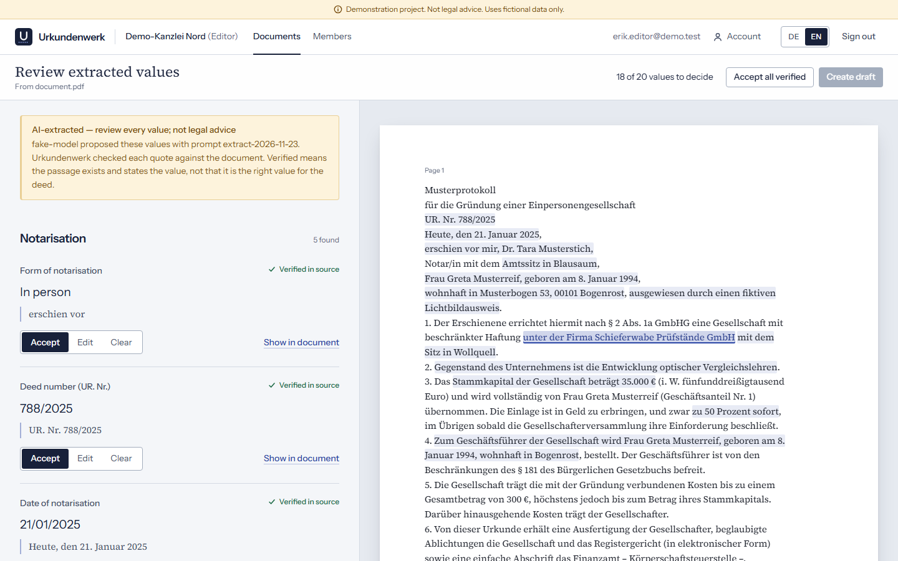
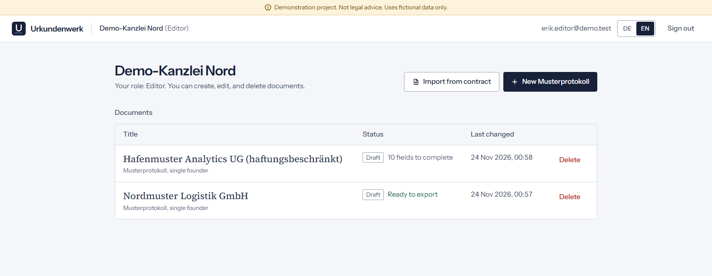

# Urkundenwerk

Urkundenwerk is an AI-assisted document builder for German law firms. It
prepares the statutory `Musterprotokoll` (Anlage 1 a) GmbHG) and a draft
`Handelsregisteranmeldung` for a single-founder GmbH or UG. Both documents
are assembled deterministically from versioned templates and structured case
data and can be downloaded as PDF or DOCX.

> **Demonstration project. Not legal advice.** Urkundenwerk uses fictional case
> data and public legal texts only.

**Live demo: [urkundenwerk.vercel.app](https://urkundenwerk.vercel.app)**.
Use one-click sign-in with a shared fictional demo account (editor, viewer, or
member of two firms). Demo drafts are reset nightly.


## Features

- **Musterprotokoll builder.** A form in the order of the deed, with a live A4
  preview built in the browser from the same `DocumentModel` that the exports
  use. Missing values show as labelled dotted lines and filled values in ink.
  Choosing either in the preview focuses its field.
- **Handelsregisteranmeldung.** Switch to the filing step in the same draft
  to enter the court, domestic business address, contribution paid and
  managing director's assurances. The live preview uses the director
  appointed in the deed and leaves the certification for the notary.
- **Schema-validated XML.** Download structured filing data after validation
  against the [versioned project XSD](packages/core/schemas/registeranmeldung-v1.xsd).
  Electronic court submission would need a separate XJustiz integration.
  See the [mapping note](docs/xjustiz-mapping.md).
- **Rule checks while typing.** A deterministic rule engine in core checks
  the data against the GmbHG and the BeurkG: minimum and UG capital, the
  payment due before registration, the legal form in the Firma, who may be
  Geschäftsführer and from what age, dates of birth and notarisation, business
  purposes that are too general, and the formation cost cap. Each rule has a
  stable code, a severity, and a legal reference. Findings appear next to the
  field and in a **Checks** panel that links to the field. Errors block the
  download; warnings and notes do not.
- **AI explanations, optional.** Any finding can be explained in plain
  German or English, in the UI language, by an LLM. The rules decide; the model only explains, and its
  answers are labelled as AI-generated and not legal advice. See
  [AI and privacy](#ai-and-privacy).
- **Import from a contract.** Upload an existing deed or articles of
  association as PDF or DOCX. An LLM proposes values for a new draft, each
  with a verbatim quote, and Urkundenwerk's own code checks that every quote
  exists in the document and states its value. On the review screen each
  value sits next to the document as it was read: select a value to see its
  passage, or a passage to see its value. You accept, edit, or clear every
  value; nothing is saved until you create the draft, and the builder then
  checks it like any other. See [AI and privacy](#ai-and-privacy) and
  [Evaluation](#evaluation).
- **Drafts that survive.** Changes are saved automatically after a short pause,
  with a visible and announced save status. A new document takes its Firma as
  its title.
- **PDF and DOCX exports.** A Node route handler validates the stored draft
  with the schema and the rules and returns the rendered file, or `422` with
  the paths and rule codes of the errors.
- **German and English.** The whole interface is available in German and
  English. See [Languages](#languages).
- **Firms and roles.** Each firm sees only its own documents. Editors and
  admins write. Viewers get a read-only builder and can download. Members of
  several firms switch between them.

- **Agentic workflow via MCP.** An MCP server lets Claude Code, Claude
  Desktop, or another agent create, fill in, check, and export drafts as
  the signed-in user. See [Agentic workflow via MCP](#agentic-workflow-via-mcp).

The design direction is recorded in [`docs/design.md`](docs/design.md).




| Landing page                                  | Documents of a firm                              |
| --------------------------------------------- | ------------------------------------------------ |
|  |  |

## Languages

The UI speaks German, in the terms a notary's office uses (Gesellschafter,
Stammkapital, Einlage, UR-Nr., Registergericht), and English, which keeps
the German terms of art with a short gloss. A DE | EN switch in the header
changes the language at any time without losing typed input, and the
choice is kept in a cookie. Without one, the browser's preferred language
decides, and German is the default. URLs are the same in both languages.

Dates and amounts follow the UI language: `07.03.1990` and `25.000 €` in
German, `07/03/1990` and `€25,000` in English. Date fields accept the
format they show and store ISO dates. AI explanations are written in the UI
language. The generated Musterprotokoll, Handelsregisteranmeldung, and XML
are always German. Rule checks in core carry stable codes and numeric
params, and the web app words them in either language
([ADR-0012](docs/adr/0012-ui-languages.md)).


## Roadmap

| Milestone                                                                      | Scope                                                                  | Status  |
| ------------------------------------------------------------------------------ | ---------------------------------------------------------------------- | ------- |
| [M1 · Foundation](https://github.com/Timerk/urkundenwerk/issues/1)             | Monorepo, CI, Supabase Auth, and row-level security (RLS)              | Done    |
| [M2 · Template engine](https://github.com/Timerk/urkundenwerk/issues/2)        | Deterministic DOCX and PDF rendering                                   | Done    |
| [M3 · Rule checks](https://github.com/Timerk/urkundenwerk/issues/3)            | Validation of structured formation data                                | Done    |
| [M4 · AI extraction](https://github.com/Timerk/urkundenwerk/issues/4)          | Extract structured data with source citations and evaluate the results | Done    |
| [M5 · XML export](https://github.com/Timerk/urkundenwerk/issues/5)             | Handelsregisteranmeldung and XSD-validated XML filing data             | Done    |
| [M6 · MCP server](https://github.com/Timerk/urkundenwerk/issues/6)             | Expose the shared domain workflows over MCP                            | Done    |
| [M7 · Audit, roles, and GDPR](https://github.com/Timerk/urkundenwerk/issues/7) | Audit log, role-based access, and data protection workflows            | Done    |
| [M8 · Deployment](https://github.com/Timerk/urkundenwerk/issues/8)             | Deploy the portfolio demo                                              | Planned |

## Stack and layout

The project uses pnpm, Next.js App Router, React, TypeScript, Tailwind CSS, Zod,
and Supabase (Postgres, Auth, and RLS). Vitest, pgTAP, and Playwright run in
GitHub Actions, and Docker Compose runs the standalone web build locally.

## Deployment

The hosted demo uses Vercel and Supabase in Frankfurt. Follow the
[deployment guide](docs/deployment.md) to provision the shared accounts,
set the AI budget, and schedule the draft reset.

Live demo: <https://urkundenwerk.vercel.app> (Vercel `fra1`, Supabase `eu-central-1`).

| Path                                         | Purpose                                                                                                               |
| -------------------------------------------- | --------------------------------------------------------------------------------------------------------------------- |
| [`apps/web`](apps/web)                       | Next.js app, Playwright tests, and Dockerfile                                                                         |
| [`apps/mcp`](apps/mcp)                       | MCP server that lets an AI agent draft, validate, and export documents as the signed-in user                          |
| [`packages/core`](packages/core)             | Framework-free TypeScript domain package and Zod schemas                                                              |
| [`packages/render`](packages/render)         | Node DOCX and PDF export for the [template engine](packages/core/README.md)                                           |
| [`packages/ai`](packages/ai)                 | Server-only LLM port, Anthropic and fake adapters, and explanations                                                   |
| [`packages/extraction`](packages/extraction) | Ingestion, LLM extraction with verified citations, and a [fictional evaluation corpus](packages/extraction/README.md) |
| [`supabase`](supabase)                       | Migrations, seed data, pgTAP tests, and local config                                                                  |
| [`docs/adr`](docs/adr)                       | Architecture decisions                                                                                                |

The shared TypeScript config enables `strict` and `noUncheckedIndexedAccess`.
It leaves `exactOptionalPropertyTypes` off so app and schema types can use the
same optional property conventions as Next.js and Zod.

## Local development

Use Node.js 24 LTS (`.nvmrc`), pnpm 12.23.0, and a running Docker engine (for
example Docker Desktop) for the local Supabase stack.

```sh
pnpm install --frozen-lockfile
pnpm db:start   # Postgres, Auth, and the Data API; applies migrations and seed data
pnpm db:env     # writes the local URL and publishable key to apps/web/.env.local
pnpm dev
```

Open <http://localhost:3000> and sign in with one of the fictional demo users.
Their password is `demo-password-123`. It exists only in the local seed data.

| Email                     | Firm              | Role   |
| ------------------------- | ----------------- | ------ |
| `anna.admin@demo.test`    | Demo-Kanzlei Nord | admin  |
| `erik.editor@demo.test`   | Demo-Kanzlei Nord | editor |
| `victor.viewer@demo.test` | Demo-Kanzlei Nord | viewer |
| `sara.admin@demo.test`    | Demo-Kanzlei Süd  | admin  |
| `mia.multi@demo.test`     | Demo-Kanzlei Nord | editor |
| `mia.multi@demo.test`     | Demo-Kanzlei Süd  | viewer |

Each firm has one fictional draft. Nord has a complete Musterprotokoll and
register filing. Süd has an unfinished Musterprotokoll.

Local sign-up skips email confirmation (`[auth.email]` in
[`supabase/config.toml`](supabase/config.toml)), so `/signup` signs the new
user in and creates their firm immediately. The hosted demo disables public
sign-up. [`.env.example`](.env.example) lists all variables.

To run the production image locally, start the Supabase stack and run
`pnpm db:env` before `docker compose up --build`. Open the same URL.
Compose reads the web app's local environment file and reaches the
Supabase gateway on the host.

| Command                             | Purpose                                              |
| ----------------------------------- | ---------------------------------------------------- |
| `pnpm lint`                         | Check JavaScript and TypeScript with ESLint          |
| `pnpm format` / `pnpm format:check` | Write or check formatting with Prettier              |
| `pnpm typecheck`                    | Type-check all workspace packages                    |
| `pnpm test`                         | Run the workspace unit tests                         |
| `pnpm build`                        | Build the standalone production app                  |
| `pnpm test:e2e`                     | Run the Chromium tests against the production build  |
| `pnpm db:start` / `pnpm db:stop`    | Start or stop the local Supabase stack               |
| `pnpm db:reset`                     | Recreate the local database from migrations and seed |
| `pnpm db:test`                      | Run the pgTAP database tests                         |
| `pnpm db:lint`                      | Lint the database schema                             |
| `pnpm db:types`                     | Regenerate `packages/core/src/db/database.types.ts`  |
| `pnpm db:env`                       | Write the local Supabase variables for the web app   |

Before running the end-to-end tests locally, install Chromium with
`pnpm --filter @urkundenwerk/web exec playwright install chromium`, start the
database with `pnpm db:start`, and run `pnpm build`. To refresh the README
screenshots, run `pnpm db:reset` and then
`SCREENSHOTS=1 pnpm test:e2e e2e/screenshots.spec.ts`.

## Agentic workflow via MCP

[`apps/mcp`](apps/mcp/README.md) is a local stdio MCP server with eight
tools: list firms and documents, get a document, create and update a
draft, validate it with the rule engine, export it as PDF or DOCX, and
delete it. An agent turns a user's facts into structured draft data, reads
the rule findings with their legal references, asks for what is missing,
and exports the deed once no error remains.

- **Same rights as the user.** The server signs in to Supabase Auth with a
  user's credentials and runs every query with that user's JWT, so RLS
  applies exactly as in the browser. It refuses secret and service-role
  keys ([ADR-0011](docs/adr/0011-mcp-server-with-user-session.md)).
- **No generated legal text.** The tools move structured data through the
  same schema, rules, template, and renderers as the web app. The agent
  never writes deed text.
- **Setup.** `claude mcp add` for Claude Code and a JSON snippet for Claude
  Desktop are in the [MCP server README](apps/mcp/README.md), with the
  tool reference and an example conversation.

## Audit, membership, and account data

Drafts have an activity history, and firm admins can filter the complete
firm audit log. Admins manage roles and share one-use invitation links.
Urkundenwerk sends no invitation emails, and the hosted demo requires
invitees to have existing accounts. The Account page offers a JSON
download and account erasure. See the [privacy and data protection notes](docs/privacy.md).

## AI and privacy

Two features use an LLM, and neither lets it write legal text or decide
anything on its own ([ADR-0002](docs/adr/0002-deterministic-legal-text.md)).
Both are off unless configured, and both run behind the same
provider-agnostic port with adapters for Anthropic and OpenAI and a
scripted fake ([ADR-0007](docs/adr/0007-llm-port-and-adapters.md)). One
provider is active at a time, chosen by configuration.

### Extraction from a contract

The model proposes; Urkundenwerk's code decides what is verified
([ADR-0009](docs/adr/0009-llm-extraction-with-verified-citations.md)).

- **What is sent.** The full text of the uploaded document, as Urkundenwerk
  read it, with a static, versioned prompt. Unlike explanations, extraction
  cannot work without the text, and it contains personal data. The demo
  therefore uses fictional documents only, and the upload page says what is
  sent and names the configured provider and model. The OpenAI adapter
  sends `store: false` to disable storage for later API retrieval. Abuse
  monitoring retention follows [OpenAI's data controls][openai-data].
  Importing real client data would need a lawful basis, a processing
  agreement with the provider, a review of
  its retention and international transfers, and a review under the
  professional secrecy rules for lawyers and notaries.
- **What is stored.** Nothing until you confirm. The upload is read in
  memory, and the text and the model's proposals go back to your browser.
  Creating the draft stores only the values you accepted or edited, as a
  normal draft. Logs record failure kinds only.
- **What comes back.** Per field a value, a verbatim quote, and the segment
  it starts in, constrained to a schema and validated again. Our code anchors
  each quote in the source, normalises the value to the draft's type, and
  checks that the quote states it. Anything that fails is shown as
  unverified with the reason, never dropped or trusted silently.
- **Prompt injection.** The document is treated as data in a delimited
  block, there are no tools, and the output can only be field proposals. A
  value whose quote does not state it, or that is quoted from a passage
  reading like an instruction to an AI, is not verified, and such passages
  are flagged on the review screen.
- **Human review.** Nothing is pre-accepted. Unverified values need an
  explicit decision, and the review screen is labelled as AI-extracted and
  not legal advice. Only editors and admins can import, six times per user
  every ten minutes, PDF or DOCX up to 4 MB.

### Explanations of rule findings

The rule engine finds the issues. An LLM may then explain one in plain
German or English, whichever the UI uses, with a suggested fix. The model never decides whether data is
valid.

- **What is sent.** Only the rule code, its legal reference, the rule's
  one-sentence summary, the issue's params, which are numbers and booleans
  such as amounts and limits, and the answer language (`de` or `en`). Names, dates of birth, addresses, the
  Firma, and other text from the draft have no field to travel in. A test
  checks the request for them.
- **What comes back.** At most three sentences and a suggested fix per
  issue, checked against the asked-for codes. Anything else, and any failure,
  falls back to the rule's own summary in the UI language. The panel shows
  the model and the prompt version.
- **Limits.** Only members of the document's firm can ask. PostgreSQL enforces
  ten paid explanation attempts per user and minute across instances. The bounded
  in-memory cache keys on code, params, language, model, and prompt version.
  Each paid attempt also reserves part of the shared daily AI budget through
  the signed-in user's database client.

### Configuration

AI is off unless configured. Without it, "Import from contract" explains
that AI is not set up, and the Checks panel shows the rules' own summaries.
To use your own key, add it to `apps/web/.env.local`, which Git ignores:

```sh
# ANTHROPIC_API_KEY=<your key>     # selects Anthropic
# OPENAI_API_KEY=<your key>        # selects OpenAI
# AI_PROVIDER=fake                # scripted answers without a key or network
# AI_MODEL_EXPLAIN=claude-haiku-5-5   # gpt-6-luna with OpenAI
# AI_MODEL_EXTRACT=claude-opus-5-5    # gpt-6.1-terra with OpenAI
# AI_EXTRACT_TIMEOUT_MS=120000
```

With both keys set, Anthropic is used unless `AI_PROVIDER` says otherwise.

With `AI_PROVIDER=fake`, explanations are scripted and extraction finds a
few fields with fixed patterns, so the whole flow can be tried without a
key. The production server reads these settings at request time. Tests and
CI use the fake and never call a paid API.

Paid calls require a positive daily budget in PostgreSQL. It defaults to
zero, including on the local stack. See the [deployment guide](docs/deployment.md#5-configure-and-deploy-the-vercel-project)
for the operator SQL.

## Evaluation

Extraction is measured on the fictional corpus in
[`packages/extraction/eval`](packages/extraction/README.md): 8 dev and 16
test documents (statutory Musterprotokolle, authored articles, and
minutes, as PDF and DOCX) with 374 gold values and their source passages,
plus an adversarial prompt-injection document.

- **Scores.** Precision, recall, and F1 over field values, micro-averaged,
  in a strict mode and a lenient mode that accepts close wording for free
  text. Citation accuracy is the share of correct values whose citation
  verifies and overlaps the gold passage. Grounded recall is the share of
  gold values that were found with a correct citation.
- **Grounding.** Verified rate is the share of predictions our checks
  verified, and verified precision the share of verified values that were
  right. Together they show how far the badge on the review screen can be
  trusted.
- **Cost.** Latency per document, tokens, and a cost estimate from list
  prices.
- **Protocol.** Prompts are developed on the dev split only. The test split
  is used for reporting and never for tuning. Scores describe these
  synthetic documents, not scanned or real notarial files.

On 2026-11-23, we ran the regex baseline and three OpenAI models on the test
split (16 documents, 254 labelled fields) with prompt `extract-2026-11-23`
and medium reasoning effort. The comparison covers OpenAI, and the app
also supports Anthropic.

| Predictor         | Strict P | Strict R | Strict F1 | Lenient F1 | Citation accuracy | Grounded recall | Verified rate | Verified precision | Failed | Median latency | Tokens in / out | Est. cost |
| ----------------- | -------: | -------: | --------: | ---------: | ----------------: | --------------: | ------------: | -----------------: | -----: | -------------: | --------------: | --------: |
| regex-baseline    |    90.4% |    26.0% |     40.4% |      40.4% |             86.4% |           22.4% |             — |                  — |      — |              — |               — |         — |
| llm-gpt-6.2-sol   |    97.2% |    97.2% |     97.2% |      98.8% |             95.1% |           92.5% |         98.0% |              97.2% |      0 |         11.4 s | 41,868 / 13,562 |     $0.22 |
| llm-gpt-6.1-terra |    96.8% |    95.7% |     96.2% |      97.8% |             96.3% |           92.1% |         97.2% |              96.7% |      0 |         12.2 s | 41,212 / 14,920 |     $0.09 |
| llm-gpt-6-luna    |    93.3% |    93.3% |     93.3% |      96.5% |             96.2% |           89.8% |         95.3% |              94.6% |      0 |          8.3 s | 41,212 / 16,461 |     $0.01 |

All three models raised strict recall from 26.0% to 93.3–97.2% and strict
F1 from 40.4% to 93.3–97.2%. Among strictly correct values, 95.1–96.3% had
matching citations, up from 86.4% for the baseline, and 94.6–97.2% of
verified model values matched the gold labels. The per-document reports
show that models often returned full sentences for identification details
and notary notes where the labels selected shorter phrases, and Luna
overstated three share capital amounts by a factor of 100. Sol led strict
F1, grounded recall, and verified precision by about one percentage point,
but with 16 fictional test documents that gap is within noise, and Sol cost
$0.22 for this run against $0.09 for Terra. Terra is therefore the OpenAI
extraction default: it matches Sol within the margin of this sample, leads
citation accuracy, and costs less than half as much. Luna, at $0.01, is the
budget option but made the only gross errors (amounts off by 100×).

To reproduce the comparison, put `OPENAI_API_KEY` in `apps/web/.env.local`
or export it and run the following command.

```sh
pnpm --filter @urkundenwerk/extraction eval -- --predictor regex-baseline \
  --predictor llm --provider openai --model gpt-6.2-sol \
  --model gpt-6.1-terra --model gpt-6-luna --split test
```

Add `--dry-run` to estimate tokens and cost before the run. To evaluate
Claude models, use `--provider anthropic` (the default),
`ANTHROPIC_API_KEY`, and Claude model IDs. Reports go to
`packages/extraction/eval/results/`, which Git ignores.

[openai-data]: https://developers.openai.com/api/docs/guides/your-data

## Security model

- **Tenants.** Each law firm is a tenant. Users get access to a tenant only
  through a row in `tenant_memberships`, so one user can belong to several
  firms.
- **Roles.** `admin` manages the firm and its members, `editor` creates and
  edits documents, and `viewer` reads them. Only admins add, change, or remove
  memberships, and every tenant keeps at least one admin.
- **Row-level security.** Postgres enforces isolation, not the app. Every
  table in `public` has RLS enabled and forced, with policies for the
  `authenticated` role only. The policies use `SECURITY DEFINER` helpers in a
  `private` schema that the Data API does not expose. Anonymous requests have
  no table privileges. See [ADR-0003](docs/adr/0003-tenancy-with-row-level-security.md).
- **Documents.** `documents` rows store structured input, never legal text.
  Members read their firm's documents, editors and admins write them, and
  column grants keep the tenant, template version, and author fixed. Server
  actions, the export route, and the MCP server use the signed-in user's
  Supabase client, so RLS authorizes every query. See
  [ADR-0005](docs/adr/0005-document-drafts.md).
- **Authentication.** The Next.js proxy refreshes the Supabase session.
  Protected pages verify the user with the Auth server through
  `supabase.auth.getUser()` and do not trust the session cookie alone.
- **Data minimisation.** `profiles` stores a display name only. Email
  addresses stay in Supabase Auth. Uploaded contracts are read in memory and
  never stored; only values a user confirms become a draft.
- **Tests.** pgTAP tests in [`supabase/tests`](supabase/tests) check RLS on
  every table through the catalog, so new tables are covered automatically.
  They also sign in as members of two tenants and prove that reads, writes,
  role escalation, and anonymous access across tenants fail. Playwright covers
  sign-in, sign-up, the redirect for unauthenticated users, the builder for
  editors and viewers, documents and exports across firms, the contract
  import with its review for editors and its refusal for viewers, and the
  German UI with the language switch.

## How this project is built

An orchestrating agent plans milestones and reviews pull requests.
Implementation agents work on feature branches. Changes land through reviewed
pull requests with green CI and are squash-merged using the PR title as the
commit message. The engineering conventions are in [`AGENTS.md`](AGENTS.md).
