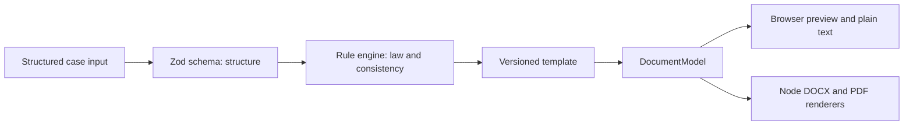

# Template engine



```ts
import { getTemplate, toPlainText } from "@urkundenwerk/core";

const template = getTemplate("musterprotokoll-einpersonen");
const context = { referenceDate: "2026-11-23" }; // today, passed in
const result = template.validate(formInput, context);
if (result.success) {
  const model = template.build(result.data, context);
  const preview = toPlainText(model);
  // A rich preview can use each run's kind and field path.
}
```

## Register filing

The same formation draft can carry an optional `filing` section. Use
`getTemplate("handelsregisteranmeldung-gmbh")` to check, preview or build
the filing. `validateRegisterFiling(draft, context)` checks the deed and
filing together and returns complete data on success. For XML, use the
Node entry point:

```ts
import { validateRegisterFiling } from "@urkundenwerk/core";
import {
  buildRegisterFilingXml,
  validateRegisterFilingXml,
} from "@urkundenwerk/core/register-filing-xml";

const result = validateRegisterFiling(draft, { referenceDate: "2026-11-23" });
if (result.success) {
  const xml = buildRegisterFilingXml(result.data, {
    generatedAt: "2026-11-23T12:00:00Z",
  });
  if (!(await validateRegisterFilingXml(xml))) {
    throw new Error("Register filing XML failed validation");
  }
  // Deliver the XML after validation.
}
```

The [filing template source](src/templates/handelsregisteranmeldung-gmbh/SOURCE.md)
records its legal bases. The [v1 XSD](schemas/registeranmeldung-v1.xsd)
defines the project XML contract. See the
[XJustiz mapping](../../docs/xjustiz-mapping.md) for electronic submission.

The registry exposes metadata, a structural Zod schema, the rules, and a
builder for each template. The schema checks required fields, types,
formats, and ranges. The rules check the law and cross-field consistency
([ADR-0006](../../docs/adr/0006-rule-engine.md)). The builder runs both and
throws `MusterprotokollValidationError` when a rule reports an error. Omit
incomplete optional notarial fields to produce dotted blanks. Use ISO
calendar dates and integer cents in case data. Capital is limited to 1
through 999,999,999 whole euros by the supported number-to-words range.

## Rules

`runRules(templateId, draft, { referenceDate })` returns issues sorted by
severity. Each issue has a stable `code`, a `severity`, the affected
`paths`, a deterministic English `message`, and `params` that hold only
numbers and booleans. Rules never read the clock. Each rule in the registry
also has a `legalReference` and a one-sentence `summary`.

| Code                              | Severity | Legal reference                        |
| --------------------------------- | -------- | -------------------------------------- |
| `field_required`                  | error    | § 2 Abs. 1a GmbHG, Anlage 1 a) GmbHG   |
| `field_invalid`                   | error    | § 2 Abs. 1a GmbHG, Anlage 1 a) GmbHG   |
| `birth_date_not_in_future`        | error    | § 10 Abs. 2 BeurkG                     |
| `company_legal_form_suffix`       | error    | § 4 Satz 1, § 5a Abs. 1 GmbHG          |
| `share_capital_whole_euros`       | error    | § 5 Abs. 2 Satz 1 GmbHG                |
| `gmbh_capital_minimum`            | error    | § 5 Abs. 1 GmbHG                       |
| `ug_capital_below_gmbh_minimum`   | error    | § 5a Abs. 1 GmbHG                      |
| `ug_contribution_full`            | error    | § 5a Abs. 2 Satz 1 GmbHG               |
| `contribution_minimum_payment`    | error    | § 7 Abs. 2 GmbHG                       |
| `director_founder_natural_person` | error    | § 6 Abs. 2 Satz 1 GmbHG                |
| `director_full_age`               | error    | § 6 Abs. 2 Satz 1 GmbHG, §§ 2, 106 BGB |
| `notarisation_date_plausible`     | warning  | § 9 Abs. 2 BeurkG                      |
| `founder_minor`                   | warning  | §§ 1629, 1643 Abs. 1, 1852 Nr. 2 BGB   |
| `company_purpose_specific`        | warning  | § 3 Abs. 1 Nr. 2 GmbHG                 |
| `formation_costs_capped`          | info     | Anlage 1 a) GmbHG, Nr. 5               |

Ages count the day of birth as a full day (§ 187 Abs. 2 Satz 2 BGB), so a
person is 18 on their 18th birthday; someone born on 29 February reaches an
age on 1 March in common years. Age rules use the notarisation date, or the
reference date while it is open. The purpose and date checks are heuristics
and therefore warnings.

Saved form input uses `musterprotokollDraftSchema`, a strict deep-partial of the
input schema with length limits. It keeps the fields of both founder and
director alternatives. `normaliseDraft(draft)` selects the chosen
alternatives, drops blank text, and trims it as the schema would;
`validateMusterprotokoll(draft, context)` validates the result with the
schema and the rules.
`buildMusterprotokollPreview(draft)` assembles the same wording from an
incomplete draft without validating it, with blank runs for missing values. It
is meant for the live preview; exports always use the validating builder.

The browser can consume `DocumentModel` directly. A filled run identifies its
source with a dot-separated field path, which may recur in several clauses.
Blank runs expose the path for the missing optional value. The plain-text
renderer is used for comparisons and golden tests.

Consumers handle `kind: "signatures"` as a group containing `closing` runs and
ordered `signatories` with display labels. The in-person template appends this
group after clause 7. Video exports end at clause 7, with electronic signing
handled outside the app. See the procedural additions in the statutory source.

The [statutory source](src/templates/musterprotokoll-einpersonen/SOURCE.md)
records the wording and footnotes. The template selects the applicable
salutations, contribution alternative, and video wording. The founder's
optional `identificationDetails` supplements the identification blank with
case-specific details about the notarial identification, marital status,
consent, or representation where supplied. The notary can complete the deed
details and notes.

Use `renderDocx(model)` and `renderPdf(model)` from `@urkundenwerk/render` on the
Node server to obtain `Uint8Array` output. Both exporters keep the closing and
signature lines together on one page. Run
`pnpm --filter @urkundenwerk/render sample` for fictional drafts in
`packages/render/out/`.
