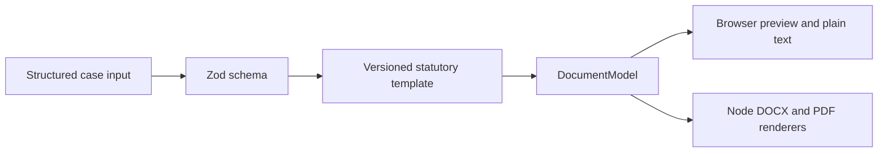

# Template engine



```ts
import { getTemplate, toPlainText } from "@urkundenwerk/core";

const template = getTemplate("musterprotokoll-einpersonen");
const result = template.schema.safeParse(formInput);
if (result.success) {
  const model = template.build(result.data);
  const preview = toPlainText(model);
  // A rich preview can use each run's kind and field path.
}
```

The registry exposes metadata, a Zod schema, and a builder for each template.
The builder validates its input. Zod issues expose `path` and `code`. Template
refinements include a stable `params.rule` value. Omit incomplete optional
notarial fields to produce dotted blanks. Use ISO calendar dates and integer
cents in case data. Capital is limited to 1 through 999,999,999 whole euros by
the supported number-to-words range.

The browser can consume `DocumentModel` directly. A filled run identifies its
source with a dot-separated field path, which may recur in several clauses.
Blank runs expose the path for the missing optional value. The plain-text
renderer is used for comparisons and golden tests.

The [statutory source](src/templates/musterprotokoll-einpersonen/SOURCE.md)
records the wording and footnotes. The template selects the applicable
salutations, contribution alternative, and video wording. The founder's
optional `identificationDetails` supplements the identification blank with
case-specific details about the notarial identification, marital status,
consent, or representation where supplied. The notary can complete the deed
details and notes.

Use `renderDocx(model)` and `renderPdf(model)` from `@urkundenwerk/render` on the
Node server to obtain `Uint8Array` output. Run
`pnpm --filter @urkundenwerk/render sample` for fictional drafts in
`packages/render/out/`.
